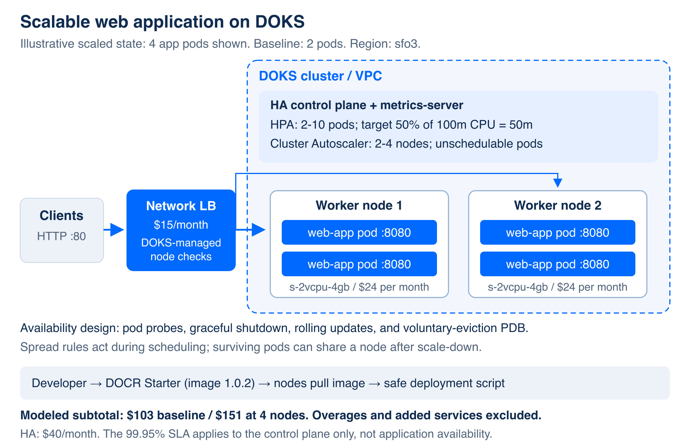

# Scalable Web App on DigitalOcean Kubernetes

A dependency-free Node.js app with a DigitalOcean network Load Balancer, Horizontal Pod Autoscaler (HPA), and a node pool configured for Cluster Autoscaler. Built for a SaaS customer's scalability, performance, reliability, and cost goals.

**Submission:** [combined PDF](output/pdf/DOKS_TAM_Case_Study.pdf), [setup guide](docs/SETUP_GUIDE.md), [cost/performance](docs/COST_AND_PERFORMANCE.md), [reliability results](docs/RELIABILITY.md), [two-page QBR](docs/QBR_SUMMARY.md), and [evidence index](evidence/README.md).

**GitHub:** https://github.com/pooja1909/do-k8s-scalable-webapp

The deployed app is version **1.0.2**, served at **http://137.184.244.5**. The submission includes source code, deployable manifests, the combined PDF, and reproducible benchmark and reliability evidence.



## Design and evidence

| Goal | Design and qualification |
| --- | --- |
| Scalability | HPA targets 50% of a 100m request (50m average per pod), within 2-10 replicas. Node autoscaling is configured for 2-4 nodes; it responds to unschedulable pods and was not exercised in these tests. |
| Performance | Light and CPU-heavy endpoints are reported separately. CPU work yields between short chunks to keep probes responsive while exercising available worker capacity. |
| Reliability | HA control plane, topology spread, probes, graceful shutdown, rolling updates, and PDB. Timed HTTP and pod-state logs cover deployment and voluntary pod recovery. Placement is checked after scaling because surviving pods can become unevenly distributed. |
| Cost | Modeled $103 baseline; $115.86 if two extra nodes run 6 hours/day for 30 days; $151 with four continuously running nodes. These are infrastructure projections, not invoices or spending caps. |

## Repository map

| Path | Purpose |
| --- | --- |
| `app/` | App, Node 22 Dockerfile, HTTP regression tests. |
| `k8s/` | Namespace, replica-free Deployment, DOKS-managed LB checks, HPA, PDB, optional load generator. |
| `scripts/03-deploy.sh` | Migrates last-applied replica ownership before redeploying; verifies cluster identity. |
| `scripts/benchmark.sh` | Saves raw hey output, image identity, versions, commands, and before/during/after/recovery snapshots. |
| `scripts/reliability-check.py` | Plans or executes a monitored rollout or one PDB-respecting pod eviction; logs HTTP responses and pod state. |
| `scripts/99-teardown.sh` | Read-only plan by default; identity checks and explicit execution/confirmation for deletion. |
| `docs/`, `evidence/`, `output/pdf/` | Handoff source, actual observations, and final submission. |

## Deploy

Install and authenticate `doctl`, `kubectl`, Docker with buildx, and Python 3. Install `hey` for benchmarks. Edit `scripts/config.env` for your own account; its current registry name matches the observed demo image.

```bash
./scripts/01-create-infra.sh  # creates billable resources; explicit HA and Kubernetes version
./scripts/02-build-push.sh   # linux/amd64 image, unique 1.0.2 tag
./scripts/03-deploy.sh      # verifies identity, applies resources, waits for readiness
```

For an existing cluster, skip creation. Verify the Kubernetes context first. Always use the deployment script: when needed, it removes only `replicas` from the saved apply configuration, preserving the live autoscaled count.

## Demonstrate and capture

```bash
./scripts/demo-load-balancing.sh
./scripts/demo-autoscaling.sh watch
./scripts/demo-autoscaling.sh start  # separate terminal; internal demo traffic
./scripts/demo-autoscaling.sh stop
./scripts/benchmark.sh light        # 60-second public-LB test, 50 workers, fresh connections
./scripts/benchmark.sh work         # run after the first test and recovery finish
python3 scripts/reliability-check.py pod-recovery            # read-only plan
python3 scripts/reliability-check.py pod-recovery --execute  # monitored pod eviction
```

Run endpoint benchmarks without the internal load generator. Default tests disable keep-alive; set `KEEP_ALIVE=true` to test connection reuse separately. The script requires two ready replicas and an idle HPA, and checks the live release. Inspect placement after recovery. If the two replicas share a node, the monitored pod eviction can restore spread when both workers are eligible; verify the resulting placement. See the evidence index for measured results and scope.

## Local validation

```bash
cd app
npm test
node server.js
# From repository root:
python3 scripts/test-safety.py
```

The HTTP tests cover malformed URLs, invalid/zero/capped work durations, normal endpoints, concurrent CPU work with responsive health checks, and graceful shutdown. Safety tests mock cloud commands; they never delete real resources.

## Cleanup

```bash
./scripts/99-teardown.sh                          # read-only plan
./scripts/99-teardown.sh --execute                # typed cluster confirmation; preserves registry
./scripts/99-teardown.sh --execute --delete-registry
```

Deleting a cluster deletes all its workloads. Review every namespace in the plan, verify registry ownership before opting in, and inspect leftover Load Balancers, volumes, and account billing afterward. See the setup guide for troubleshooting and the evidence index for remaining validation gaps.
